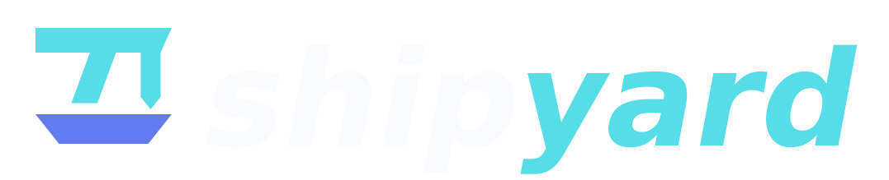

<picture>
  <source media="(prefers-color-scheme: light)" srcset="media/Shipyard-on-light.svg">
  
</picture>

# Shipyard

**The Xbox 360 platform under 3Shipsty and Warwing.**

Shipyard is the Xbox 360 code shared by ports built on libultraship. It handles graphics, audio, input and saves, and builds each game's data from the player's ROM on the console. Games compile it in from source and keep their own game code in their own repositories.

## Games

| Game | Port of | Status |
|---|---|---|
| [3Shipsty](https://github.com/becaring/3Shipsty) | Ship of Harkinian 9.2.3 (Ocarina of Time) | Tested on hardware |
| [Warwing](https://github.com/becaring/Warwing) | BattleShip (Super Smash Bros. 64) | Tested on hardware |
| [2Ship3Shipsty](https://github.com/becaring/2Ship3Shipsty) | 2Ship2Harkinian 5.0.1 (Majora's Mask) | In testing |

## Reporting a problem

Report problems in the game's repository. Its bug report form asks for the logs.

## Support Me
 

If you had fun with 3Shipsty or Warwing, a donation is NEVER required but always appreciated <3

## Building and Using Shipyard

[Building and tests](docs/BUILDING.md) covers the host checks, [Consumers](docs/CONSUMERS.md) explains how a game pins Shipyard, and [Architecture](docs/ARCHITECTURE.md) describes what Shipyard owns.

## Credits

Developed with AI coding assistants; design, integration and hardware validation by becaring.

## License

Original Shipyard code is [MIT](LICENSE). Third-party source keeps its own license and is credited in [NOTICE](NOTICE.md). The repository contains no ROMs, game assets or Xbox 360 SDK files.
